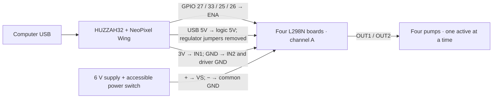

# HUZZAH32 pump controls + NeoPixel FeatherWing

**Start with the standalone NeoPixel test**, then use this sketch with the app's
**Test brine lights…** window to check Python/USB before attaching motor drivers.
See the [test order and USB walkthrough](../README.md). Then test
[one/two pump driver channels](../pump_driver_test/README.md) before real combined
runs. There is no need to merge code.

For the **original Adafruit HUZZAH32 ESP32 Feather**, the **32-pixel 4×8 NeoPixel
FeatherWing**, your **four 6 V peristaltic pumps**, and **four L298N boards**.
This sketch uses channel A on each driver. The main Python app now has a
**lights-only USB test** for four brine choices. Actual motor commands remain in
the separate bench helper; the voice/GSR recipe does not trigger a pour.

The sketch starts with every pump off. It runs one pump at a time, shows the
scheduled sequence on the pixels, and supports a lights-only preview. Full-speed
on/off control avoids adding PWM and its version-dependent ESP32 setup.

## 1. Wiring

Disconnect USB and the 6 V adapter while wiring. **This changes the earlier
two-direction-pin test wiring:** here the Feather switches each driver's **ENA**,
while **IN1/IN2 are fixed**. Follow this table rather than combining the sketches.

On **each of the four L298N boards**:

| Connection | Wire it to |
| --- | --- |
| `VS` / `VIN` / terminal marked `12V` | Your separate **6 V supply +** |
| `GND` | 6 V supply − and Feather GND (common ground for all boards) |
| `5V` logic terminal | Feather **USB** pin, with the **5V-EN regulator jumper removed** |
| `IN1` | Feather **3V** (fixed forward direction) |
| `IN2` | Common GND |
| `ENA` | Its Feather control pin below, **ENA jumper removed** |
| `ENA` to GND | **10 kΩ pull-down resistor** at the driver, to hold it off during boot/reset |
| `OUT1`, `OUT2` | The two wires of that board's pump |
| Unused channel B | No motor; remove its ENB jumper and tie ENB, IN3, IN4 to GND |

The **5V-EN regulator jumper** and **ENA channel-enable jumper** are different;
both are removed for this wiring. USB supplies logic only; the separate 6 V
adapter supplies the motors. Do not connect the 6 V supply to Feather USB, BAT,
3V, or GPIO. If your board's jumper/terminal labels differ, resolve that before
applying power. The L298 accepts 3.3 V control signals with its logic supply at 5 V.

| Pump | Feather GPIO → driver ENA | Pixel indices | Active colour |
| --- | --- | --- | --- |
| 1 | **27** → driver 1 ENA | 0–7 | Pink |
| 2 | **33** → driver 2 ENA | 8–15 | Amber |
| 3 | **25 / A1** → driver 3 ENA | 16–23 | Green |
| 4 | **26 / A0** → driver 4 ENA | 24–31 | Blue |

Label the four tubes 1–4 to match the pixels. Ingredients are not hard-coded.
If a pump moves water in the wrong direction, disconnect power and swap its two
OUT wires. No code change is needed.

The Wing stacks on the Feather and gets power through its headers. Its default
data-jumper position maps to **GPIO 32** on the original HUZZAH32. It is labelled
`6` in examples for some other Feather models; **do not use ESP32 GPIO 6**. If you
previously moved the Wing's solder jumper, set `PIXEL_PIN` in `pump_config.h` to
the corresponding HUZZAH32 GPIO. Keep only one data jumper bridged. The Wing has
its own data level shifter. Brightness is kept at 24/255 for USB-powered testing.

An optional normally-open **Stop button between GPIO 14 and GND** immediately
cancels the sequence; releasing it does not restart anything. You can omit the
button while bench testing. Keep a physical switch/disconnect in the 6 V motor
supply accessible: the GPIO button and software watchdog rely on the ESP32 running.



The L298 drops voltage internally, so a 6 V pump on a 6 V supply can run slower
or struggle to start. A timer cannot fix insufficient motor voltage. Do not raise
the supply to 12 V to compensate. Check your adapter's current rating: the pump's
6 V / 5 W rating implies about 0.83 A nominal, with extra headroom needed at startup.

Use plain water and discard it during these tests, as discussed for the supplied
non-food-safe tubing. Calibrate again after fitting the final suitable tubing.

## 2. Upload with Arduino IDE

1. Install **esp32 by Espressif Systems** in Boards Manager if necessary.
2. Install **Adafruit NeoPixel** in Library Manager.
3. Open `pump_controller.ino` (keep the accompanying `.h` files in this folder).
4. Select **Adafruit ESP32 Feather**, and the Feather's USB port. This is the
   original HUZZAH32 target, not an ESP8266, ESP32-S3, S2 or Feather V2.
5. Upload while motor power is disconnected. The sketch does not start a pump
   when uploading, resetting, or opening the USB port.
6. Open Serial Monitor at **115200 baud**, with **Newline** line ending.
7. Send `HELLO`, then `PREVIEW`. Each group of eight LEDs takes a turn for two
   seconds. **PREVIEW always leaves all motor enables LOW.**

No uploading or motor activation is performed by the repository's automated checks.

## 3. What the pixels mean

Each bank of eight belongs to one numbered pump. `PREVIEW` lets you identify the
physical banks; orientation depends on which way you hold the Wing.

- **Dim blue:** idle, all pumps off.
- **Dim amber:** queued, or armed and waiting for a command.
- **Lights-only PREVIEW:** the entire active row is pink / amber / green / blue;
  every other row is off. It goes dark at completion or Stop.
- **Real motor run:** the active pump's coloured bar fills as its timer advances.
- **Green bank (real run):** that pump's scheduled step finished.
- **Red (outside preview):** stopped, button pressed, malformed input, or connection timeout.

These are commanded motor states and elapsed time, **not measured flow or confirmation
that the motor is physically turning**. There is a 300 ms all-off gap between pumps.

## 4. First water test

After wiring, close Serial Monitor and use the repository's USB helper. It sends
the heartbeat needed for longer runs. Replace COM5 with your Feather's port:

```powershell
cd C:\Users\sabri\Documents\_GITHUB\DirtyMinds
.\.venv\Scripts\python.exe pump_control.py ports
.\.venv\Scripts\python.exe pump_control.py --port COM5 preview
.\.venv\Scripts\python.exe pump_control.py --port COM5 run 1 2
.\.venv\Scripts\python.exe pump_control.py --port COM5 sequence 2 2 2 2
```

`run 1 2` runs **pump 1 for 2 seconds**. `sequence` runs pumps 1, 2, 3, 4 in order;
use `0` for any pump you want to skip. `preview 2 4 0 3` shows the same timed schedule
without turning on motors. Press **Ctrl+C** in the running helper to cancel.

```powershell
.\.venv\Scripts\python.exe pump_control.py --port COM5 status
.\.venv\Scripts\python.exe pump_control.py --port COM5 stop
```

Only one program can hold the COM port. Use Ctrl+C in the active helper or the
hardware button to stop it; a second helper cannot open an already occupied port.
Opening the port can reset this Feather. This helper first checks for the correct
firmware before it will arm or run anything. It does not work against the GSR sketch.
Use a separate Arduino/COM port for GSR while this Feather controls pumps.

For a short manual Serial Monitor test, send `ARM`, then `RUN 1 2000`. Longer
manual runs stop after 3 seconds unless you keep sending `PING`; use the helper
for those. A reset never resumes a queued sequence.

## 5. Calibrate each pump

Prime the tubing into a waste container, then measure a 10- or 30-second run into
a measuring vessel. Repeat for each pump with the actual tubing, liquid and lift
height. Calculate **ml per second = collected ml / elapsed seconds**. Then
**required seconds = target ml / measured ml per second**. No advertised flow rate
is used as a dosing calibration in this code.

The desktop voice/recipe app does not automatically send a cocktail to the pumps.
Use measured durations with the helper after testing. Per-pump maximum is 180 s;
combined running time is capped at 600 s. Larger measured doses need a deliberate
second run. Pump labels and calibration can be connected to recipe amounts later.

## USB command reference

All commands are newline-delimited ASCII at 115200 baud. Firmware durations are
**milliseconds**; the Python helper takes **seconds**.

| Command | Behaviour |
| --- | --- |
| `HELLO` | Reports `DIRTYMINDS_PUMPS 1` and limits |
| `STATUS` | Reports armed/running/preview, active pump and remaining time |
| `PREVIEW` | Four 2000 ms LED steps, with every motor output LOW |
| `PREVIEW 1000 2000 0 1000` | Custom LED-only sequence |
| `ARM` | Arms one real sequence; expires after 30 s idle |
| `RUN 1 2000` | Requires ARM; runs one numbered pump |
| `SEQ 1000 2000 0 1000` | Requires ARM; runs nonzero steps sequentially |
| `PING` | Keep-alive; send at least once per second during real runs |
| `STOP` or `!` | Off immediately; clears arm and queue. `!` needs no newline |

Valid nonzero duration: 100–180000 ms. `0` skips a step. Invalid arguments do not
start a job. `ERR BUSY` rejects attempts to replace a running job. Oversized or
invalid input stops the motors. The loop keeps checking timers and the Stop button
while reading input. A missing heartbeat stops a real run within 3 seconds and
clears its remaining steps. `START`, `PUMP_DONE`, `DONE`, and `STOPPED` report progress.

## Verification and sources

The sketch is compiled for `esp32:esp32:featheresp32`, using ESP32 core **3.3.12**
and Adafruit NeoPixel **1.15.5** on this machine. Its compiler also executes
six `static_assert` checks against the actual timing engine: boot/arming, sequential
timing and skipped channels, preview never enabling a motor, Stop/connection loss,
heartbeat/millis rollover, and duration bounds/arm expiry. These check the control
logic; they do not test real wiring, flow, current, or the LEDs. A separate compile
check rejects duplicate assignments among the pump, pixel and Stop pins.

```powershell
arduino-cli compile --fqbn esp32:esp32:featheresp32 --build-path .build\pump_controller arduino\pump_controller
.\.venv\Scripts\python.exe -m unittest discover -s tests -v
```

Pin/power references: [Adafruit HUZZAH32 pinouts](https://learn.adafruit.com/adafruit-huzzah32-esp32-feather/pinouts),
[NeoPixel FeatherWing pinouts](https://learn.adafruit.com/adafruit-neopixel-featherwing/pinouts),
[ST L298 datasheet](https://www.st.com/resource/en/datasheet/l298.pdf),
[Velleman VMA447 pump manual](https://cdn.velleman.eu/downloads/29/vma447_a4v01.pdf).
The Wing's GPIO 32 mapping follows the matching header position on the original
HUZZAH32; check the actual solder jumper if the Wing has been modified.
